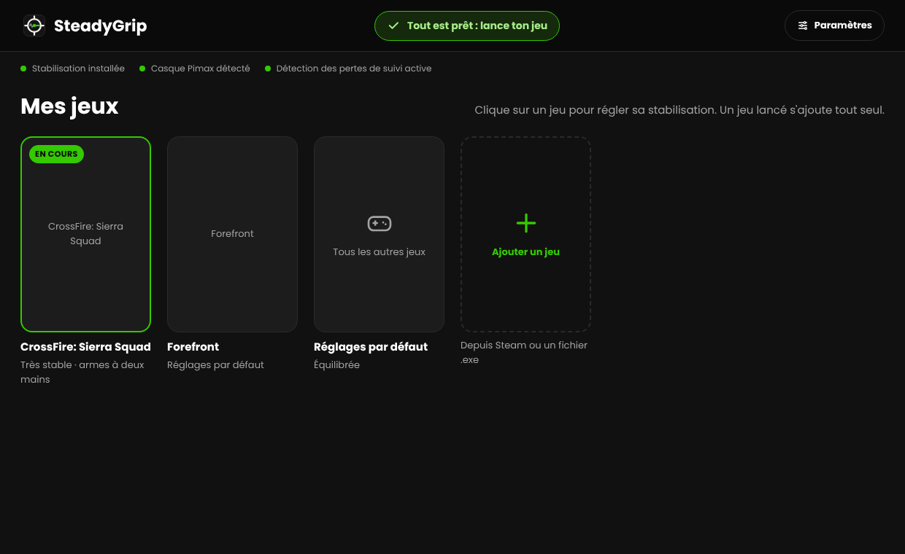
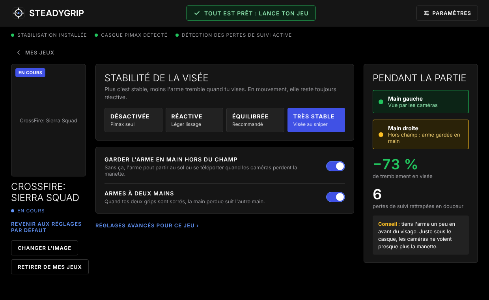

# SteadyGrip

*Français : [README.md](README.md)*

Controller stabilization for headsets whose controllers are tracked by the headset's own cameras (tested with the Pimax Dream Air SLAM), in every OpenXR game:

- **steady aim**: controller micro-jitter is smoothed with no lag on real motion (70–77 % less jitter measured in CrossFire: Sierra Squad);
- **smooth motion**: no more stutter when moving the weapon;
- **no more weapon dropping to the floor**: when the cameras lose a controller, SteadyGrip keeps it in your hand, then brings it back to its true position smoothly instead of teleporting it;
- **two-handed weapons**: while both grips are squeezed, a lost hand follows the other one.

Each game has its own settings: a game you launch is added to "Mes jeux" (My games) automatically, with its Steam cover art. The interface follows Pimax Play's colors, either **Pimax Classic** or **Pimax EVO**. The interface is in French.

SteadyGrip uses OpenXR's official API layer mechanism: nothing is injected into the game, the image and the headset are untouched, only controller poses are changed.

> SteadyGrip is an independent project, not affiliated with Pimax. It does not modify any Pimax file or program: it only reads, in memory, the tracking state the Pimax service writes to its own log.

## Installation

1. Download `SteadyGrip-<version>-win64.zip` from the [latest release](../../releases/latest).
2. Extract the whole archive (right-click, "Extract All").
3. Double-click **`Installer.bat`**.
   - Windows may show "Windows protected your PC": the program is not signed. Click "More info", then "Run anyway".
   - Accept the administrator prompt: it is needed to register SteadyGrip with OpenXR and to read the controllers' tracking state in the Pimax service.

The program installs to `C:\SteadyGrip`, with a desktop and Start menu shortcut. To **update**, do the same: your settings and games are kept. The extracted folder can be deleted afterwards.

**Requirements**: Windows 10 or 11, 64-bit, a Pimax headset with camera-tracked controllers (Pimax Play or Pimax EVO) and an OpenXR game. Nothing else to install: the window's WebView2 engine ships with Windows 11 and up-to-date Windows 10.

**Uninstall**: double-click `Desinstaller.bat` in `C:\SteadyGrip` (it removes the OpenXR layer and the shortcuts), then delete that folder.

## Usage

1. Start **SteadyGrip** (desktop shortcut) before playing. The top banner should read "Tout est prêt : lance ton jeu" (everything is ready). If it asks you to move a controller out of view, do so for a few seconds.
2. Launch your game: it shows up in "Mes jeux" marked **EN COURS** (running).
3. Click the game to pick its **aiming stability** (Off, Responsive, Balanced, Very stable) and turn on **Armes à deux mains** (two-handed weapons). Changes apply immediately, without restarting the game.

**Tip**: hold the weapon slightly in front of your face. Right under the headset (closer than 25 cm), the cameras barely see the controller: 31–37 losses per minute, versus under 2 a little further out. In games, turn off automatic shouldering and automatic scope aiming, which bring the controller back there.

## Learn more

- [User guide](docs/GUIDE.en.md): what each setting does, tracking losses and the loss map, recommended in-game settings, troubleshooting.
- [CHANGELOG](CHANGELOG.en.md): what's new in each version.
- [Development](docs/DEVELOPMENT.md): building from source, packaging, code layout.

MIT license ([LICENSE](LICENSE)). Third-party components: [THIRD-PARTY.md](THIRD-PARTY.md).
