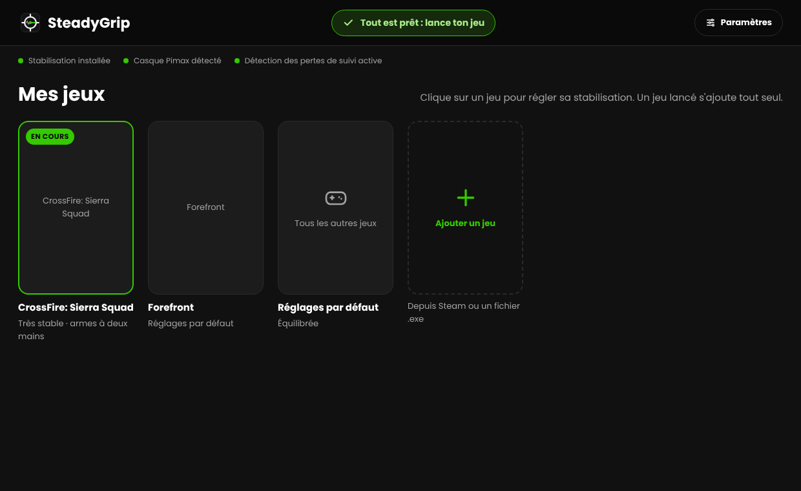
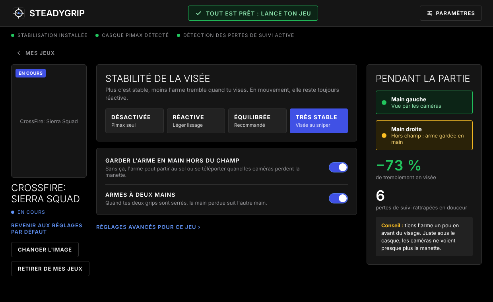

# SteadyGrip

*English: [README.en.md](README.en.md)*

Stabilisation des manettes pour les casques dont les manettes sont suivies par leurs propres caméras (testé avec le Pimax Dream Air SLAM), dans tous les jeux OpenXR :

- **visée stable** : le micro-tremblement des manettes est lissé, sans retard sur les mouvements (−70 à −77 % de tremblement mesuré dans CrossFire: Sierra Squad) ;
- **mouvements fluides** : plus de saccades quand on déplace l'arme ;
- **fini l'arme qui part au sol** : quand les caméras perdent une manette, SteadyGrip la garde en main, puis la ramène en douceur à sa vraie position au lieu de la téléporter ;
- **armes à deux mains** : quand les deux grips sont serrés, la main perdue suit l'autre.

Chaque jeu a ses réglages : un jeu lancé s'ajoute tout seul à « Mes jeux », avec sa jaquette Steam. L'interface reprend les couleurs de Pimax Play, au choix **Pimax Classic** ou **Pimax EVO**.

SteadyGrip passe par le mécanisme officiel d'OpenXR : rien n'est injecté dans le jeu, l'image et le casque ne sont pas touchés, seule la pose des manettes est modifiée.

> SteadyGrip est un projet indépendant, sans lien avec Pimax. Il ne modifie aucun fichier ni aucun programme de Pimax : il lit seulement, en mémoire, l'état de suivi que le service Pimax écrit dans son propre journal.

## Installation

1. Téléchargez `SteadyGrip-<version>-win64.zip` dans la [dernière version](../../releases/latest).
2. Extrayez toute l'archive (clic droit, « Extraire tout »).
3. Double-cliquez sur **`Installer.bat`**.
   - Windows peut afficher « Windows a protégé votre ordinateur » : le programme n'est pas signé. Cliquez sur « Informations complémentaires », puis « Exécuter quand même ».
   - Acceptez la demande d'autorisation d'administrateur : elle sert à déclarer SteadyGrip auprès d'OpenXR et à lire l'état de suivi des manettes dans le service Pimax.

Le programme s'installe dans `C:\SteadyGrip`, avec un raccourci sur le bureau et dans le menu Démarrer. Pour une **mise à jour**, faites la même chose : vos réglages et vos jeux sont conservés. Le dossier extrait peut être supprimé ensuite.

**Ce qu'il faut** : Windows 10 ou 11, 64 bits, un casque Pimax suivi par ses caméras (Pimax Play ou Pimax EVO) et un jeu OpenXR. Rien d'autre à installer : le moteur WebView2 de la fenêtre est déjà dans Windows 11 et Windows 10 à jour.

**Désinstallation** : double-cliquez sur `Desinstaller.bat` dans `C:\SteadyGrip` (il retire la couche OpenXR et les raccourcis), puis supprimez ce dossier.

## Utilisation

1. Lancez **SteadyGrip** (raccourci du bureau) avant de jouer. Le bandeau du haut doit dire « Tout est prêt : lance ton jeu ». S'il demande de faire sortir une manette du champ, faites-le quelques secondes.
2. Lancez votre jeu : il apparaît dans « Mes jeux » avec la mention **EN COURS**.
3. Cliquez sur le jeu pour choisir sa **stabilité de la visée** (Désactivée, Réactive, Équilibrée, Très stable) et activer **Armes à deux mains**. Les changements s'appliquent tout de suite, sans relancer le jeu.

**Conseil** : tenez l'arme un peu en avant du visage. Juste sous le casque (à moins de 25 cm), les caméras ne voient presque plus la manette : 31 à 37 pertes par minute, contre moins de 2 un peu plus loin. Dans les jeux, désactivez l'épaulement automatique et la visée automatique des lunettes, qui y ramènent la manette.

## En savoir plus

- [Guide d'utilisation](docs/GUIDE.md) : ce que fait chaque réglage, les pertes de suivi et la carte des pertes, les réglages conseillés dans les jeux, le dépannage.
- [CHANGELOG](CHANGELOG.md) : les nouveautés de chaque version.
- [Développement](docs/DEVELOPPEMENT.md) : compiler depuis les sources, construire le paquet, organisation du code.

Licence MIT ([LICENSE](LICENSE)). Composants tiers : [THIRD-PARTY.md](THIRD-PARTY.md).
